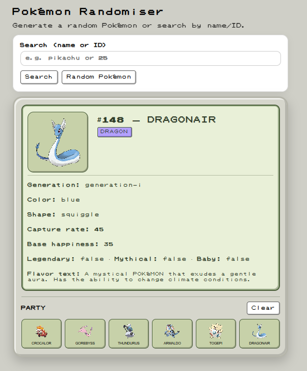

# Pokémon Randomiser

Generate a random Pokémon or search for one by name or number, and watch your party of six fill up, all in a Game Boy–style interface.

**[Live app →](https://pokemon-randomiser.netlify.app/)**



## Built with

- **React 19** (Create React App) and plain CSS
- **[PokéAPI](https://pokeapi.co/)** via the native `fetch` API

## How it works

- **A small API layer.** [`src/api/pokeapi.js`](src/api/pokeapi.js) keeps every request in one place, normalises input (so `Pikachu`, `pikachu ` and `25` all work) and turns a 404 into a helpful message: *"Pokémon not found. Try a name (pikachu) or ID (25)."*
- **Cancellable requests.** Each request accepts an `AbortSignal`, so a new search cancels the previous one instead of letting a slow, outdated response overwrite it.
- **A running party.** Every Pokémon you find joins your party, which keeps the six most recent. Click one to bring it back up.

## Run locally

```bash
npm install
npm start    # http://localhost:3000
```

---

By [Zoe Blighton](https://zoeblighton.com).
